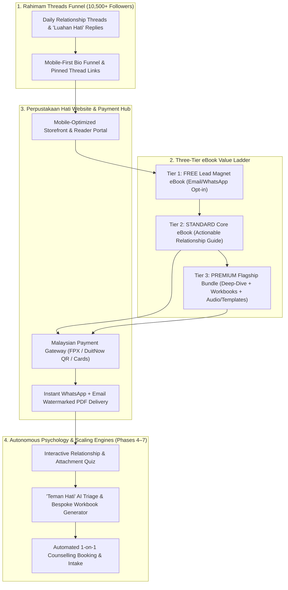

# 📖 Perpustakaan Hati

> **An Autonomous Psychology & Relationship Wellness Ecosystem for Malaysians**  
> **Brand Ambassador:** Rahimam (**10,500+ Followers on Threads**)  
> **Primary Acquisition Channel:** Threads (Organic Thread-to-Funnel Ecosystem)  
> **Repository:** [github.com/tradernonymous/perpustakaan_hati](https://github.com/tradernonymous/perpustakaan_hati)

---

## 🌟 Vision & Overview

**Perpustakaan Hati** (*The Library of the Heart*) is an autonomous psychological wellness and relationship guidance platform built specifically for Malaysians navigating relationship struggles—ranging from anxious/avoidant attachment, communication breakdown, marriage conflicts, and emotional burnout to heartbreak recovery.

Fronted by **Rahimam**—who already commands a warm, engaged community of **10,500+ followers on Threads**—the platform is designed to convert high-engagement Threads conversations into an automated, stigma-free healing journey:
1. **Read & Resonate on Threads** ->
2. **Download the Free Tier eBook / Lead Magnet** ->
3. **Upgrade to Standard or Premium eBooks via Instant FPX / DuitNow Checkout** ->
4. **Ascend into Autonomous AI Triage, Bespoke Workbooks & 1-on-1 Counselling.**

---

## 🎯 Target Audience & Distribution Advantage

- **Audience:** Malaysians (ages 20–45) experiencing relationship distress, unspoken emotional wounds, pre-marital doubts, marital disconnect, or breakup recovery.
- **Language & Tone:** Empathetic, poetic yet practical Bahasa Melayu & casual Malaysian English—matching the exact voice that built Rahimam's 10.5k+ Threads following.
- **The Threads Advantage (10,500+ Followers):**
  - Threads is a **text-first, vulnerability-driven platform** where Malaysians actively share and read relationship confessions (*luahan hati*), red/green flags, and emotional reflections.
  - Because Threads readers are already in a **reading mindset**, transitioning them from a viral 5-post thread by Rahimam to a structured **Perpustakaan Hati eBook** is the highest-converting monetization path.

---

## 🏗️ Autonomous System Architecture



---

## 🗺️ Master 7-Phase Roadmap

### Phase 1: Branding Setup & Design System
*Goal: Establish a deeply comforting, trustworthy, and recognizable visual identity around Rahimam and "Perpustakaan Hati" before producing content or code.*

- [x] **Brand Strategy & Narrative Architecture:**
  - Define the core brand theme (*Gilded Grove* — a green-black lantern-lit sanctuary, emerald-foil type, antique-gold frames) and Rahimam's positioning as the trusted curator of *Perpustakaan Hati*.
  - Finalize the **official thematic names for the 3 eBook Tiers** — *Edisi Poket* (Free), *Edisi Membangun* (Standard), *Teman Hidup* (Premium flagship).
- [x] **Visual Identity & Design Tokens:**
  - Color palette sampled from the brand reference artwork (ink black, antique gold, sepia, burgundy, terracotta, cream) plus a saturated emerald green as the healing accent. See `docs/brand/visual-identity.md` and `docs/brand/design-tokens.css`.
  - Logo suite, watermark stamps (*Cop Perpustakaan Hati*), and Rahimam brand photography/avatar guidelines.
  - **Design System 3.1 "Gilded Grove" — current version.** Cinematic, lantern-lit, foil-stamped look: book-heart emblem, emerald-foil hero type, ribbon banners and scalloped tier seals. Green stays the main colour (green-black ground, emerald hero word). Rules and change process: `docs/brand/DESIGN-SYSTEM.md`. Full rationale: `docs/brand/visual-identity.md`. Preview: `docs/brand/preview/design-system-3-0.png`. The old 2.0 ink-and-gold wordmarks were removed.
  - **Drift check:** `uv run --no-project python packages/brand-tools/check-lock.py` is advisory — it lists drift (a tracked file changed since the baseline, an unsanctioned asset, a removed asset referenced again) and exits 0. Add `--strict` to make warnings fail.
  - **Use it in Doop:** the guideline `perpustakaan-hati-design-system` (source: `docs/brand/doop-guideline.md`) is saved on Doop canvas `Gr9TixlKwm` and registered in Claude's Doop registry, so any Doop canvas can adopt it via `get_guidelines` + `set_guidelines`.
  - Logo SVGs are **outlined** (type converted to vector paths) and generated by `packages/brand-tools/build-logos.py`, so they never fall back to a system font. Brand fonts (Fraunces, Source Serif 4, Inter) are subset and self-hosted in `packages/brand-tools/fonts/`.
- [x] **Multi-Format Design System:**
  - **Web UI Kit:** Reusable Tailwind CSS + `shadcn/ui` tokens for mobile-first reading and checkout. See `docs/brand/ui-kit.md`.
  - **eBook Layout Templates:** Master interior page layouts, chapter openers, reflection worksheet grids, and cover templates for all 3 tiers.
  - **Threads Visual Kit:** Quote cards, carousel templates, and teaser graphics optimized for Threads sharing.

---

### Phase 2: 3-Tier eBook Production Engine
*Goal: Produce the foundational 3-tier product ladder tailored to the #1 relationship pain points of Rahimam's 10,500+ Threads audience. (Exact tier names to be locked in after Phase 1 theme confirmation).*

- [ ] **Audience Pain-Point Mining (Threads Analytics):**
  - Analyze Rahimam's top-performing Threads posts, bookmarks, and comment sections to pick the highest-demand relationship topic for Launch #1.
- [ ] **Tier 1 — FREE Tier (*Entry / Lead Magnet*):**
  - **Purpose:** Turn the 10,500 Threads followers into owned WhatsApp & Email subscribers.
  - **Format:** 15–25 page concise diagnostic & quick-relief guide (e.g., identifying toxic patterns, attachment triggers, or 7-day emotional reset).
  - **Built-in Bridge:** Ends with a self-evaluation checklist that naturally points readers to the Standard or Premium tier.
- [ ] **Tier 2 — STANDARD Tier (*Core Actionable Guide*):**
  - **Purpose:** Impulse-friendly, high-volume paid digital product (target RM 29 – RM 49).
  - **Format:** 60–90 page comprehensive relationship psychology handbook written in Rahimam's signature voice, blending psychological frameworks (Gottman, Attachment Theory, Emotional Regulation) with Malaysian real-life scenarios.
- [ ] **Tier 3 — PREMIUM Tier (*Deep Transformation & Toolkit*):**
  - **Purpose:** High-margin flagship bundle for readers in deep relationship distress (target RM 79 – RM 149).
  - **Format:** Complete Standard eBook **PLUS** interactive printable/digital *Buku Kerja* (30-Day Healing & Communication Workbook), difficult-conversation script templates (*Skrip Bincang Hati ke Hati*), and bonus voice notes/audio reflections from Rahimam.
- [ ] **Automated Typesetting & Watermarking Pipeline:**
  - Build a repeatable Markdown -> print-grade PDF/EPUB compiler with dynamic buyer name/email watermarking to prevent piracy.

---

### Phase 3: Website Production & Malaysian Payment Gateway
*Goal: Launch a fast, mobile-first web platform optimized for traffic clicking through from Threads on mobile devices, with zero-friction Malaysian checkout.*

- [ ] **Threads-First Mobile Storefront (Next.js App Router):**
  - Ultra-fast landing experience tailored for in-app mobile browsers (Threads/Instagram webview).
  - Dedicated landing sections for the **Free Tier opt-in**, **Standard vs. Premium Tier comparison**, chapter previews, and reader confessions/testimonials.
- [ ] **Malaysian Payment Gateway Integration:**
  - Native **FPX Online Banking** and **DuitNow QR** (via **Chip-in / Billplz / ToyyibPay**) + Credit/Debit Cards & Apple Pay/Google Pay (via **Stripe**).
  - **1-Click Order Bump & Upsell:** Offer an instant upgrade from Standard -> Premium on the checkout and thank-you pages.
- [ ] **Autonomous Fulfilment & Delivery:**
  - Webhook-triggered instant delivery of signed, watermarked eBook download links via **WhatsApp** and **Email** within 10 seconds of payment.
  - Customer library lookup page so buyers can re-download their eBooks anytime.

---

### Phase 4: Threads Viral Events, Gamified Giveaways & Funnel Automation
*Goal: Turn Rahimam's 10,500+ Threads audience into a viral growth engine through interactive Threads games, community events, and automated giveaways that flood the Free -> Standard -> Premium funnel.*

- [ ] **Gamified Threads Events & Interactive Challenges:**
  - **🎯 Game 1: *"Kad Jujur Hati" (Red Flag / Green Flag / Luka Hati Bingo & Card Pull)*:**
    - Followers reply with a keyword or emoji on Rahimam's thread to "pull a card" or complete a visual Relationship Bingo card on the website, then quote-repost their result card back onto Threads.
  - **🧪 Game 2: *"Cermin Pasangan" (2-Player Couple Compatibility & Attachment Mini-Game)*:**
    - A shareable 5-question link where Partner A answers first and sends a secret challenge link to Partner B. Once both complete it, the web app unlocks their shared *"Peta Hubungan"* score card—designed specifically to be screenshot and posted on Threads.
  - **📖 Event 3: *"7 Hari Cabaran Pulih Hati" (7-Day Live Threads Healing Sprint)*:**
    - A scheduled seasonal community challenge where thousands of followers go through 1 daily relationship reflection prompt together on Threads, using the Free Tier eBook as their companion tracker.
- [ ] **Automated Threads Giveaway & Referral Mechanics (*"Hadiah Hati"*):**
  - **Milestone & Launch Giveaways:** Automated lucky-draw & referral system on the website where followers earn entries by:
    1. Downloading the **Free Tier eBook**,
    2. Sharing their quiz/game result card on Threads tagging **@rahimam**, or
    3. Inviting 3 friends via their unique referral link.
  - **Tiered Prizes:** Instant unlock of bonus reflection cards for everyone + weekly winners receiving the **Premium Tier eBook Bundle** or a **Free 1-on-1 Private Session**—while every non-winner automatically receives a time-limited RM 15–RM 20 voucher for the Standard/Premium eBook via WhatsApp/Email.
- [ ] **Automated Threads Content & Nurture Sequences:**
  - AI-assisted workflow that turns eBook chapters and anonymized follower confessions into daily high-retention Threads posts with soft CTAs.
  - 7-day empathetic WhatsApp & Email follow-up sequence that converts Free Tier & Giveaway participants into Standard/Premium buyers.

---

### Phase 5: Dynamic Personalized eBook Generator & "Teman Hati" AI Triage
*Goal: Upgrade from static eBooks to an autonomous system that generates bespoke workbooks and provides 24/7 safe-space guidance.*

- [ ] **Bespoke AI Workbook Generator:**
  - Premium buyers or quiz takers receive a **custom-generated PDF supplement** tailored to their specific relationship status (dating, engaged, married, or recovering from breakup) and attachment style.
- [ ] **"Teman Hati" 24/7 AI Companion (Trained on Rahimam's Voice):**
  - Bilingual (BM/EN) empathetic chat companion grounded in Rahimam's eBooks via RAG (Retrieval-Augmented Generation).
  - Helps users process acute relationship anxiety at 2 AM, suggests exercises from their purchased eBook, and flags when human counselling is needed.
- [ ] **Psychological Safety Guardrails:**
  - Strict crisis detection routing severe distress to Malaysian helplines (*Talian HEAL 15555*, *Befrienders*).

---

### Phase 6: Autonomous Counselling Booking & Practitioner Portal
*Goal: Introduce high-ticket human services (RM 150 – RM 350+/session) for Premium readers who need 1-on-1 or couples intervention.*

- [ ] **End-to-End Session Booking & Payment:**
  - Integrated calendar scheduling (1-on-1 emotional clarity calls, couples mediation, or panel licensed counsellors under Perpustakaan Hati).
  - Pre-paid slot locking via FPX/DuitNow and automated Google Meet + WhatsApp reminders.
- [ ] **Autonomous Pre-Session Case Briefs:**
  - Before a session starts, the system compiles the client's quiz results, purchased eBooks, and intake form into a structured 1-page psychological summary for the counsellor—saving 20 minutes of intake time.
- [ ] **Post-Session Action Plan Delivery:**
  - Automated follow-up PDF summary and homework worksheets sent to the client after their session.

---

### Phase 7: Community Ecosystem, Recurring Membership & Regional Scale
*Goal: Transform one-off eBook buyers into long-term members with predictable monthly recurring revenue (MRR).*

- [ ] **"Kelab Perpustakaan Hati" (Monthly Membership & Audio Library):**
  - Bite-sized *Audio Terapi Hati* (5-minute guided emotional regulation voice notes by Rahimam for commute or bedtime listening).
  - Monthly live anonymous Q&A / group healing sessions (*Malam Bicara Hati*).
- [ ] **Anonymous "Surat Hati" Confession & Advice Portal:**
  - Users submit anonymous relationship dilemmas on the website; selected letters receive deep psychological breakdowns from Rahimam (fueling both website SEO and viral Threads series).
- [ ] **Regional Nusantara Expansion (Malaysia -> Singapore, Brunei & Indonesia):**
  - Multi-currency checkout (MYR, SGD, BND, IDR) and localized editions of top-performing eBooks.

---

## 🛠️ Recommended Tech Stack

| Layer | Technology | Rationale |
| :--- | :--- | :--- |
| **Web & Storefront** | **Next.js (App Router) + TypeScript + Tailwind CSS + shadcn/ui** | Instant loading inside Threads mobile browser, SEO-ready, warm editorial aesthetic. |
| **Database & Storage** | **Supabase (PostgreSQL + Auth + Storage)** | Secure customer records, PDPA-compliant storage, and signed eBook download URLs. |
| **eBook Production** | **Markdown + Typst / React-PDF / Playwright PDF** | Automated compilation of all 3 eBook tiers with custom branding and dynamic buyer watermarking. |
| **Payments (Malaysia)** | **Chip-in / Billplz** (FPX & DuitNow QR) + **Stripe** (Cards) | Essential for Malaysian conversion—most Threads mobile buyers pay via FPX or DuitNow QR. |
| **Delivery & Nurture** | **Resend** (Email) + **WhatsApp API** | Instant delivery of Free, Standard, and Premium eBooks straight to the user's phone. |
| **AI & Personalization** | **Vercel AI SDK + Gemini / Claude** | Powers Phase 5 personalized workbooks, Threads content repurposing, and *Teman Hati* AI triage. |

---

## 📂 Proposed Repository Structure

```text
perpustakaan_hati/
├── docs/
│   ├── brand/                  # Phase 1: Brand theme, voice guide, tier naming & design tokens
│   └── roadmap/                # Product specs & Threads funnel playbooks
├── content/
│   └── ebooks/                 # Phase 2: Source manuscripts & worksheets
│       ├── tier-1-free/        # Lead magnet manuscript & checklists
│       ├── tier-2-standard/    # Core guide manuscript & chapters
│       └── tier-3-premium/     # Deep-dive bundle, workbook & conversation scripts
├── packages/
│   └── ebook-builder/          # Automated PDF/EPUB styling, typesetting & watermarking engine
├── apps/
│   └── web/                    # Phase 3+: Next.js storefront, checkout, quiz & client portal
└── README.md
```

---

## ⚖️ Ethics, Privacy & Compliance

1. **PDPA Compliance (Malaysia):** Reader emails, WhatsApp numbers, and relationship quiz responses are strictly protected under Malaysia's Personal Data Protection Act (PDPA).
2. **Psychoeducational Positioning:** eBooks and AI tools provide relationship education and structured self-reflection, with clear pathways to licensed professionals and Malaysian crisis hotlines (*Talian HEAL 15555*) for clinical emergencies.

---

*Built with empathy for **Perpustakaan Hati** — Turning Rahimam's community into a sanctuary for healthier hearts and relationships across Malaysia.*
