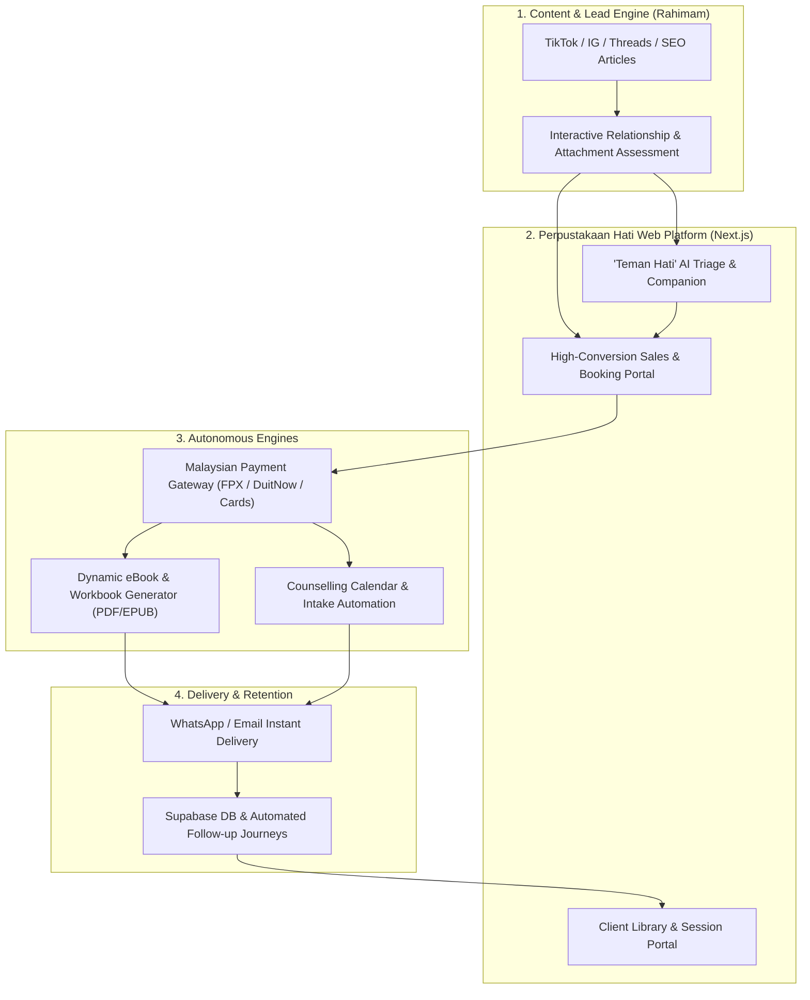

# 📖 Perpustakaan Hati

> **An Autonomous Psychology & Relationship Wellness Ecosystem for Malaysians**  
> **Brand Ambassador:** Rahimam  
> **Repository:** [github.com/tradernonymous/perpustakaan_hati](https://github.com/tradernonymous/perpustakaan_hati)

---

## 🌟 Vision & Overview

**Perpustakaan Hati** (*The Library of the Heart*) is an end-to-end autonomous platform designed to help Malaysians navigate psychological challenges, emotional healing, and relationship struggles (marriage, dating, attachment styles, communication breakdown, family dynamics, and heartbreak recovery).

Guided by ambassador **Rahimam**, the platform bridges accessible self-help education with interactive emotional support and human counselling. By combining culturally resonant Bahasa Melayu & English ("Manglish"-friendly) AI triage, bespoke dynamic eBook generation, and frictionless Malaysian payment infrastructure, **Perpustakaan Hati** turns emotional wellness into an approachable, stigma-free journey.

---

## 🎯 Target Audience & Core Problems Solved

- **Demographics:** Malaysians (ages 20–45) facing relationship distress, anxious/avoidant attachment issues, pre-marital doubts, marital conflict, or post-breakup trauma.
- **Cultural Nuance:** High sensitivity to local cultural values, family/in-law expectations, religious context, and bilingual expression (Bahasa Melayu & English).
- **Barriers Addressed:**
  1. *Stigma & Privacy:* Private, judgment-free first-step assessments and digital guides before committing to live therapy.
  2. *Affordability:* Tiered offerings ranging from free diagnostic quizzes to affordable personalized eBooks (RM 29–RM 79) and premium 1-on-1 counselling packages.
  3. *Immediate Relief:* Instant 24/7 empathetic guidance and actionable workbooks generated on demand.

---

## 🏗️ Autonomous System Architecture



---

## 🧩 Core Pillars of the Ecosystem

### 1. "Teman Hati" — Empathetic AI Triage & Assessment Companion
- **Interactive Relationship Quiz:** Diagnoses attachment styles (*Cemas / Mengelak / Selamat*), communication blockers, and emotional triggers.
- **24/7 Safe Space Chat:** Trained on Rahimam's compassionate tone and evidence-based frameworks (Gottman Method, Emotionally Focused Therapy, CBT) tailored to Malaysian contexts.
- **Safety Guardrails:** Automated crisis detection with immediate escalation pathways to Malaysian mental health hotlines (*Talian HEAL 15555, Befrienders*).

### 2. Autonomous eBook & Personalized Workbook Factory
- **Catalog eBooks:** Curated bestsellers authored/fronted by Rahimam (e.g., *Seni Memahami Pasangan*, *Pulih Dari Luka Lama*, *Komunikasi Tanpa Ego*).
- **Bespoke AI-Tailored Workbooks:** Generates a personalized PDF recovery & action guide within 60 seconds of a client completing their relationship assessment—complete with custom exercises, reflection prompts, and dynamic watermarking.

### 3. Web Storefront, Booking & Malaysian Payment Hub
- **Frictionless Local Checkout:** Native support for **FPX (Online Banking)**, **DuitNow QR**, **GrabPay / Touch 'n Go eWallet**, and credit/debit cards via **Billplz / ToyyibPay / Chip-in** + **Stripe**.
- **1-Click Upsells & Bundles:** Seamless transitions from a diagnostic quiz -> Personalized eBook -> Audio Guided Healing -> 1-on-1 Online Counselling Session.
- **Automated Counselling Operations:** Calendar syncing, pre-session intake summaries for counsellors, Google Meet/Zoom link generation, and WhatsApp reminders.

### 4. Omnichannel Content & Nurture Automation
- **WhatsApp & Email Sequences:** Automated check-ins 3, 7, and 14 days post-purchase to track emotional progress and encourage deeper healing steps.
- **Rahimam Content Pipeline:** Automated extraction of anonymized, recurring relationship questions into short-form video scripts (TikTok/Reels) and SEO blog posts.

---

## 🛠️ Recommended Tech Stack

| Layer | Technology | Rationale |
| :--- | :--- | :--- |
| **Frontend & Web App** | **Next.js (App Router) + TypeScript + Tailwind CSS + shadcn/ui** | Fast mobile-first experience, SEO-ready, warm & calming UI aesthetic. |
| **Backend & Database** | **Supabase (PostgreSQL + Auth + Storage + Edge Functions)** | Secure user profiles, assessment logs, digital asset storage, and Row-Level Security (RLS). |
| **AI & LLM Orchestration** | **Vercel AI SDK + Gemini / Claude / OpenAI + RAG** | Empathetic bilingual conversational flow and structured workbook synthesis. |
| **eBook Rendering Engine** | **React-PDF / Typst / Playwright PDF** | High-speed, print-grade PDF layout generation with custom typography and client watermarking. |
| **Payments (Malaysia)** | **Chip-in / Billplz** (FPX & DuitNow) + **Stripe** (Cards) | Highest conversion rates for Malaysian buyers who prefer FPX and QR payments. |
| **Communications** | **Resend** (Email) + **WhatsApp Business API / Fonnte** | Instant delivery of eBooks and appointment reminders directly to clients' phones. |
| **Scheduling** | **Cal.com Integration** | Self-hosted or embedded booking flow linked directly to payment webhooks. |

---

## 🗺️ Phased Product Roadmap

### Phase 1: Brand Foundation, Storefront & Flagship eBooks (Weeks 1–3)
- [ ] **Brand Identity & Design System:** Establish *Perpustakaan Hati* visual language (warm, comforting palette, typography) featuring ambassador **Rahimam**.
- [ ] **High-Conversion Landing Page:** Build the core Next.js storefront showcasing Rahimam's story, relationship resources, client testimonials, and digital library.
- [ ] **Malaysian Payment Integration:** Connect FPX / DuitNow QR & card checkout webhooks with automated order confirmation.
- [ ] **Instant Digital Delivery:** Set up secure Supabase Storage signed URLs + automated Email/WhatsApp receipt and eBook delivery.

### Phase 2: Interactive Relationship Assessment & Autonomous eBook Engine (Weeks 4–6)
- [ ] **Relationship Diagnostic Quiz:** Launch an interactive 5-minute questionnaire evaluating relationship health, attachment style, and conflict patterns.
- [ ] **Autonomous eBook Generation Pipeline:** Build the AI + PDF assembly pipeline that compiles a personalized *Panduan Hati* workbook based on the user's quiz results.
- [ ] **Automated Lead Magnet Funnel:** Offer a free 3-page "Relationship Clarity Report" in exchange for WhatsApp/Email opt-in, with an immediate upsell to the full personalized eBook.

### Phase 3: "Teman Hati" AI Companion & Counselling Booking System (Weeks 7–10)
- [ ] **"Teman Hati" AI Triage Chat:** Deploy the bilingual (BM/EN) empathetic listener trained on Rahimam's counselling philosophy to guide users and recommend relevant eBooks or sessions.
- [ ] **Counselling Booking & Intake Portal:** Integrate paid session scheduling with automated intake briefs sent to the counsellor prior to the call.
- [ ] **Safety & Crisis Protocol:** Implement strict psychological guardrails, disclaimers, and Malaysian emergency helpline routing.

### Phase 4: Autonomous Growth, Community & Retention Flywheel (Weeks 11+)
- [ ] **Client Healing Dashboard:** Personal portal for buyers to track mood journals, revisit eBooks, and manage counselling notes.
- [ ] **Automated Content Engine for Rahimam:** AI pipeline that turns trending relationship pain points into daily social media scripts, carousels, and newsletter editions.
- [ ] **Subscription & Audio Library:** Expand into guided emotional regulation audio tracks (*Audio Terapi Hati*) and monthly group support circles.

---

## 📂 Proposed Repository Structure

```text
perpustakaan_hati/
├── apps/
│   └── web/                    # Next.js storefront, quiz, AI chat & client portal
├── packages/
│   ├── ebook-engine/           # Templates, AI synthesis prompts & PDF generator
│   ├── ai-counselor/           # "Teman Hati" prompts, RAG knowledge base & guardrails
│   └── database/               # Supabase schema, migrations & TypeScript types
├── content/
│   ├── ebooks/                 # Source markdown/assets for Rahimam's core eBooks
│   └── assessments/            # Scoring rubrics for relationship & psychology quizzes
├── docs/                       # Architecture specs, brand guidelines & SOPs
└── README.md
```

---

## ⚖️ Ethics, Privacy & Compliance

1. **PDPA Compliance (Malaysia):** All personal reflections, assessment answers, and contact details are encrypted and handled strictly under Malaysia's Personal Data Protection Act (PDPA).
2. **Clinical Disclaimer:** Autonomous AI tools and eBooks are designed for psychoeducation and self-reflection, not clinical psychiatric diagnosis. High-risk users are immediately directed to licensed professionals and national crisis lines (*Talian HEAL 15555*).

---

*Built with empathy for **Perpustakaan Hati** — Empowering healthier hearts and relationships across Malaysia.*
